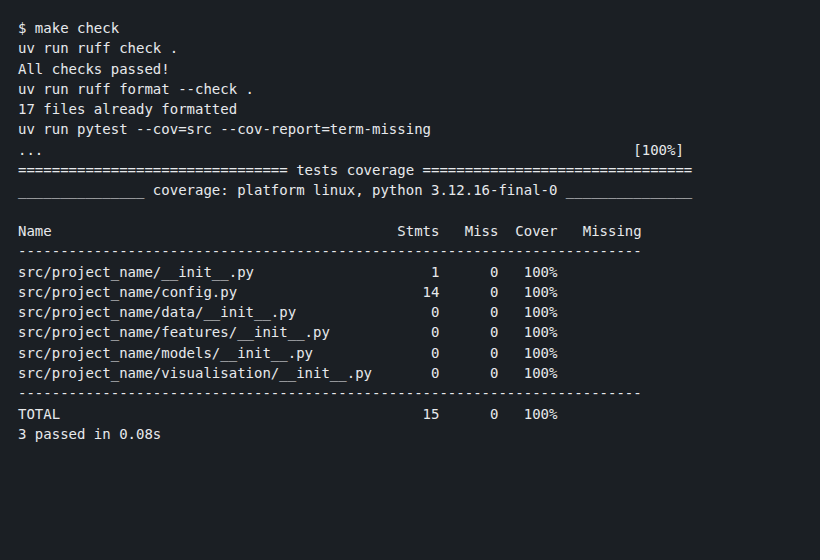

# ds-project-template

The starter repository behind every project in [my data science portfolio](https://mulengasnr.github.io). It sets the shared structure, quality checks and documentation standard.

**Problem:** portfolio projects often look different from each other, skip tests and overstate results. This template makes reproducibility, testing and honest documentation the default from the first commit.

## What you get
| Area | Included |
|---|---|
| Environment | `uv` + Python 3.12 pinned (`.python-version`, `uv.lock`) |
| Code quality | `ruff` lint + format (PEP 8, imports, Google-style docstrings, bugbear) |
| Testing | `pytest` + coverage, example tests for the config loader |
| CI | GitHub Actions: lint and test on every push and pull request |
| Config | YAML config in `configs/`, so no hard-coded paths or seeds |
| Secrets | `.env.example` only; `.env`, keys and data folders are gitignored |
| Docs | [README skeleton](docs/README_TEMPLATE.md), [documentation standard](docs/README_STANDARD.md), [model card](docs/MODEL_CARD.md), [project checklist](docs/PROJECT_CHECKLIST.md), [data provenance](data/README.md) |
| Collaboration | Issue template and pull-request checklist (including data-governance checks) |

## Use it
```bash
gh repo create MulengaSnr/<new-repo> --template MulengaSnr/ds-project-template --private --clone
cd <new-repo>
mv src/project_name src/<package_name>        # then update pyproject.toml + imports
cp docs/README_TEMPLATE.md README.md
uv sync
make check                                     # lint + tests
```

## Commands
| Command | Does |
|---|---|
| `make setup` | Create `.venv` and install dependencies |
| `make lint` | Ruff checks + format check |
| `make format` | Auto-fix formatting |
| `make test` | Tests with coverage |
| `make check` | Everything CI runs |

## Structure
```
├── app/            optional UI / API
├── configs/        YAML parameters
├── data/           raw · external · processed (gitignored) + provenance README
├── docs/           standards, model card, checklist, README skeleton
├── notebooks/      narrative analysis (logic lives in src/)
├── reports/        findings.md + figures/
├── src/project_name/{data,features,models,visualisation}
└── tests/
```



## Next steps
- Add optional add-ons (Dockerfile, MLflow config) when the MLOps project needs them
- Add a pre-commit hook once the workflow is settled
