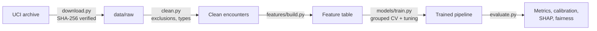

# Hospital Readmission Risk Model

Predicting which diabetic inpatients will be readmitted within 30 days, so a care team with limited follow-up capacity knows whom to prioritise.


**Status:** In development. Steps 1–3 of 7 (data acquisition, cleaning, exploratory analysis) complete. Results will be added once the model is evaluated, and none are claimed yet.

## At a glance
| | |
|---|---|
| **Problem** | Which discharged patients are at highest risk of unplanned readmission within 30 days? |
| **Data** | UCI Diabetes 130-US Hospitals 1999–2008: 99,340 encounters from 69,987 patients after exclusions, CC BY 4.0 |
| **Approach** | Patient-grouped cross-validation; logistic regression, random forest and XGBoost vs a baseline; calibrated probabilities; SHAP; fairness audit |
| **Result** | _To be reported from the held-out test set_ |
| **Stack** | Python 3.12, pandas, scikit-learn, XGBoost, SHAP, fairlearn, uv, pytest, GitHub Actions |

## 1. Business problem
Unplanned readmissions within 30 days are costly, often avoidable and widely used as a quality indicator. The NHS, for example, publishes 30-day emergency readmission rates. Hospitals can offer only a limited number of post-discharge interventions, such as pharmacist medicine reviews, follow-up calls and community nursing. This project estimates each patient's readmission risk at discharge and explains it, so those interventions go where they are most likely to help.

## 2. Objectives
- Build a model that ranks discharges by readmission risk better than a no-skill baseline, measured by PR-AUC on a patient-disjoint test set.
- Produce **calibrated** probabilities that staff can interpret.
- Translate performance into capacity terms: if the team can review the top 10% or 20% of discharges, how many readmissions would they reach?
- Explain predictions (SHAP) and audit performance across age, sex and race.

## 3. Data
Inpatient encounters with a diabetes diagnosis from 130 US hospitals, 1999–2008, published by the UCI Machine Learning Repository under CC BY 4.0. Each row is an encounter. Patients can appear more than once, so all splits are grouped by patient to prevent leakage. Full provenance, licence, checksum and data-protection notes are in [data/README.md](data/README.md).

### Cohort flow
| Step | Removed | Remaining |
|---|---:|---:|
| Raw encounters | | 101,766 |
| Exclude discharges to death or hospice (readmission impossible) | 2,423 | 99,343 |
| Exclude invalid sex (`Unknown/Invalid`) | 3 | **99,340** |

The final cohort is **69,987 patients**, and **11.39%** of encounters are readmitted within 30 days. Generated by `clean.py` into `reports/cohort_flow.json`.

**A data-quality catch:** pandas reads the string `"None"` as missing by default. In this dataset `None` in `A1Cresult` and `max_glu_serum` means *test not performed*, which is clinically meaningful (HbA1c measurement is the subject of the original study). The loader turns off pandas' default NA list and recodes these values to `"Not measured"`, and a test guards the behaviour.

## 4. Architecture


## 5. Methodology (planned)
- **Leakage control:** train/test split and all cross-validation grouped by `patient_nbr`. All preprocessing sits inside a scikit-learn `Pipeline` fitted on training folds only.
- **Exclusions:** encounters ending in death or hospice discharge, where readmission is impossible.
- **Models:** dummy baseline → logistic regression → random forest → XGBoost, with hyperparameter tuning in grouped cross-validation. The test set is used once.
- **Metrics:** PR-AUC (primary, because positives are rare), ROC-AUC, Brier score, calibration curve, and precision/recall at capacity thresholds.

- **Hold-out:** a patient-disjoint, target-stratified 20% test set (19,867 encounters, 13,951 patients) was split off **before exploration**. EDA and all model development use the training set only.

## 6. Exploratory analysis
Full narrative: [notebooks/01_eda.ipynb](notebooks/01_eda.ipynb) (training data only).


- **Prior utilisation is the strongest signal.** The 30-day readmission rate rises from 8.6% for patients with no inpatient stay in the previous year to about 37% for those with five or more (Cramér's V ≈ 0.17).
- **Discharge destination matters.** Patients sent to rehab or other inpatient care are readmitted at roughly 2–3× the rate of those discharged home.
- **HbA1c testing** is linked to slightly lower readmission (about 10% vs 11.7%). The difference is statistically significant but small (V ≈ 0.02), and it is an association, not evidence of cause.
- **Sex shows no association** (p ≈ 0.47). Race shows only small differences. The fairness audit will check model error rates by group, not just base rates.
- **Every single-variable association is weak**, so expect modest predictive performance.

**A leakage trap found and avoided:**


Counting how many times a patient appears in the dataset looks like a powerful predictor (4% vs 28%). It is leakage: a readmission *is* another encounter in the data, so the count partly contains the answer and uses events after discharge. Features use only the pre-encounter counts the data provides, and every split is grouped by patient.

_Sections on results, explainability, fairness, business interpretation and limitations will be added as each step is completed._

## Run it yourself
```bash
git clone https://github.com/MulengaSnr/readmission-risk-model.git
cd readmission-risk-model
uv sync                                            # Python 3.12 + dependencies
uv run python -m readmission_risk.data.download    # fetch + verify the dataset
uv run python -m readmission_risk.data.clean       # exclusions, target, types -> data/processed
uv run python -m readmission_risk.data.split       # patient-disjoint train/test
make eda                                           # re-run the EDA notebook + figures
make check                                         # lint + tests
```

## Project structure
```
├── configs/default.yaml     dataset URL, checksum, seed, paths
├── data/                    raw/processed (gitignored) + provenance README
├── docs/                    model card, checklist, standards
├── notebooks/               narrative analysis
├── reports/                 findings + figures
├── src/readmission_risk/    data · features · models · visualisation
└── tests/
```

## Progress
- [x] 1. Data acquisition with checksum verification
- [x] 2. Cleaning and exclusions
- [x] 3. Exploratory analysis
- [ ] 4. Feature engineering
- [ ] 5. Modelling and grouped cross-validation
- [ ] 6. Evaluation, calibration, SHAP and fairness
- [ ] 7. Documentation and review

## Author
**Enock Mulenga**, Data Scientist · [LinkedIn](https://www.linkedin.com/in/enock-mulenga-8472ba137) · [Portfolio](https://mulengasnr.github.io)
