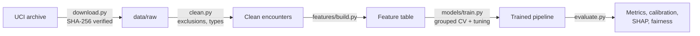
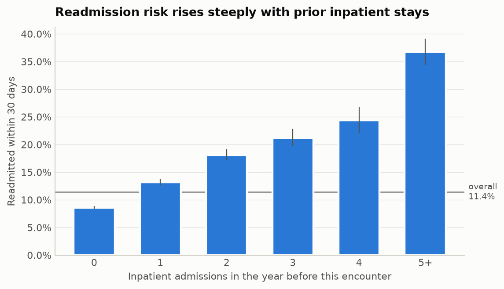
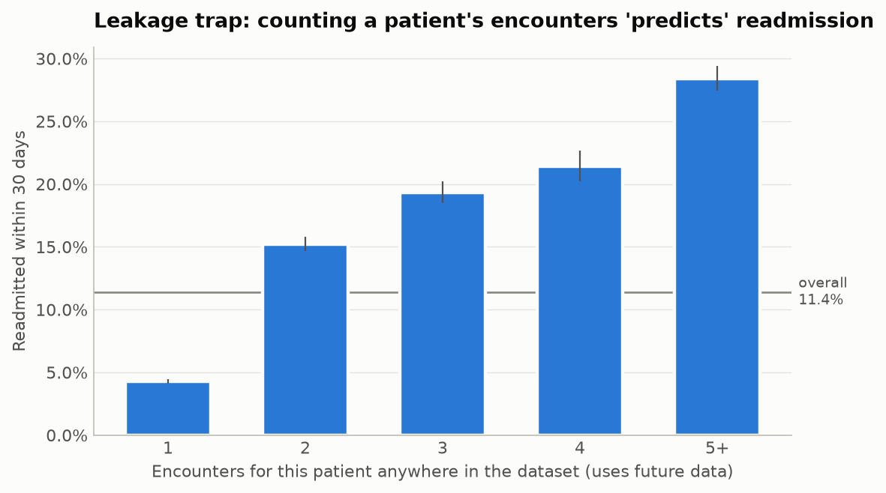
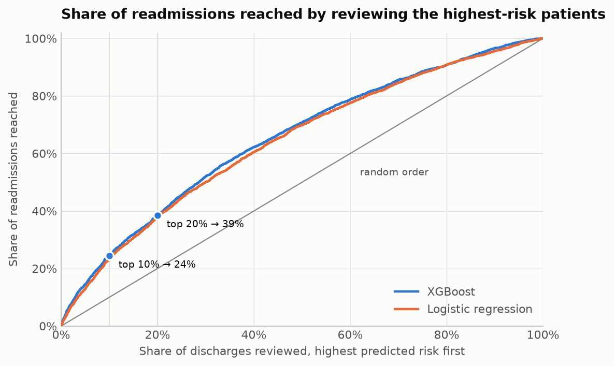
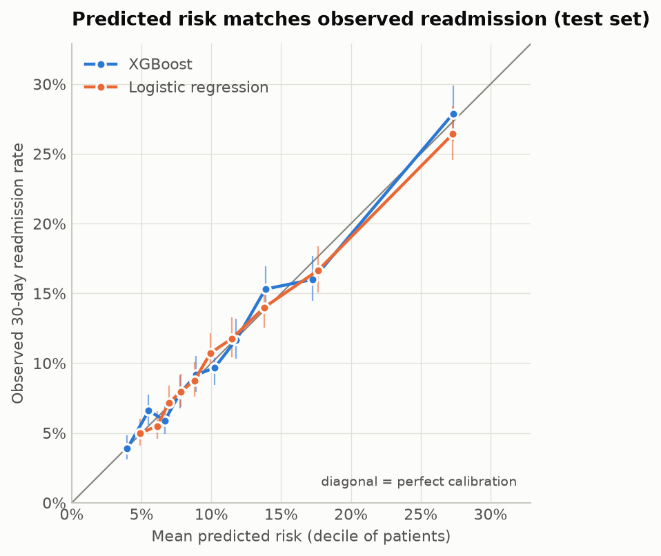
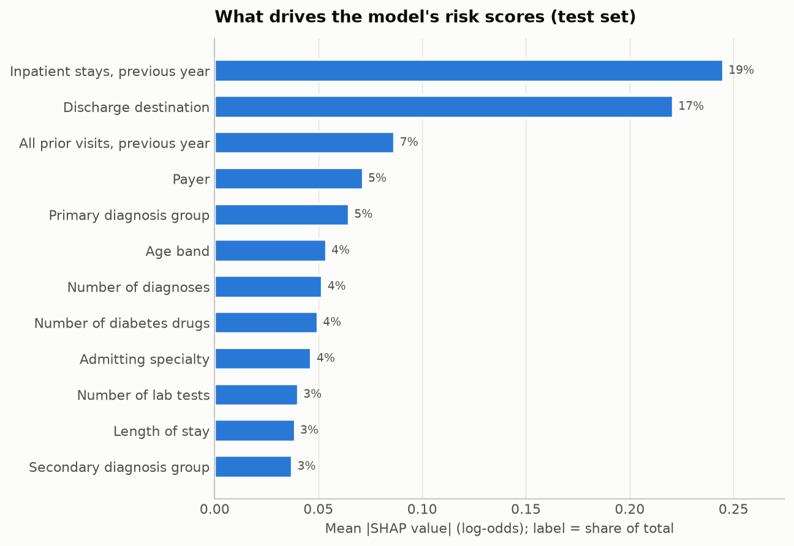
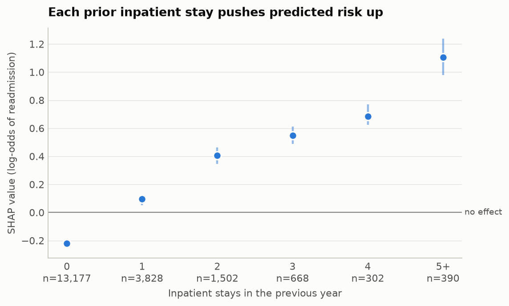
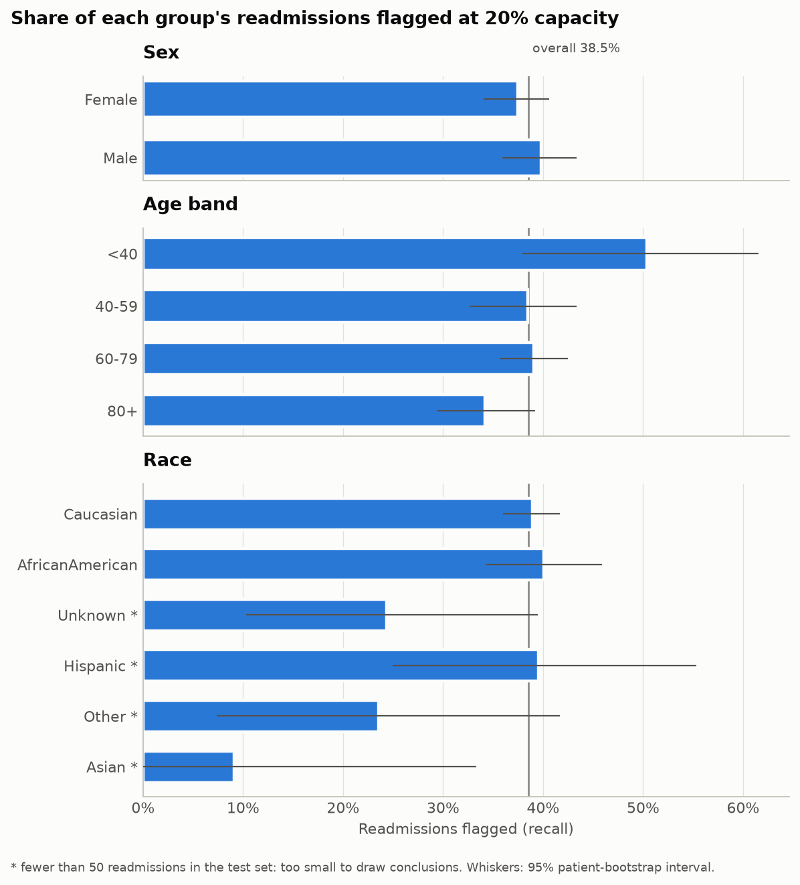

# Hospital Readmission Risk Model

Predicting which diabetic inpatients will be readmitted within 30 days, so a care team with limited follow-up capacity knows whom to prioritise.


**Status:** In development. Steps 1–6 of 7 complete: the model has been evaluated once on the held-out test set, explained with SHAP and audited for fairness. Step 7 (documentation and review) is next.

## At a glance
| | |
|---|---|
| **Problem** | Which discharged patients are at highest risk of unplanned readmission within 30 days? |
| **Data** | UCI Diabetes 130-US Hospitals 1999–2008: 99,340 encounters from 69,987 patients after exclusions, CC BY 4.0 |
| **Approach** | Patient-grouped cross-validation; logistic regression, random forest and XGBoost vs a baseline; calibrated probabilities; SHAP; fairness audit |
| **Result** | Test set: PR-AUC **0.235** (95% CI 0.216–0.257) against a no-skill 0.114. Reviewing the top 20% of discharges reaches **39%** of readmissions. Probabilities are well calibrated. |
| **Stack** | Python 3.12, pandas, scikit-learn, XGBoost (built-in TreeSHAP), matplotlib, uv, pytest, GitHub Actions |

## 1. Business problem
Unplanned readmissions within 30 days are costly, often avoidable and widely used as a quality indicator. The NHS, for example, publishes 30-day emergency readmission rates. Hospitals can offer only a limited number of post-discharge interventions, such as pharmacist medicine reviews, follow-up calls and community nursing. This project estimates each patient's readmission risk at discharge and explains it, so those interventions go where they are most likely to help.

## 2. Objectives
- Build a model that ranks discharges by readmission risk better than a no-skill baseline, measured by PR-AUC on a patient-disjoint test set.
- Produce **calibrated** probabilities that staff can interpret.
- Translate performance into capacity terms: if the team can review the top 10% or 20% of discharges, how many readmissions would they reach?
- Explain predictions (SHAP) and audit performance across age, sex and race.

## 3. Data
Inpatient encounters with a diabetes diagnosis from 130 US hospitals, 1999–2008, published by the UCI Machine Learning Repository under CC BY 4.0. Each row is an encounter. Patients can appear more than once, so all splits are grouped by patient to prevent leakage. Full provenance, licence, checksum and data-protection notes are in [data/README.md](data/README.md).

### Cohort flow
| Step | Removed | Remaining |
|---|---:|---:|
| Raw encounters | | 101,766 |
| Exclude discharges to death or hospice (readmission impossible) | 2,423 | 99,343 |
| Exclude invalid sex (`Unknown/Invalid`) | 3 | **99,340** |

The final cohort is **69,987 patients**, and **11.39%** of encounters are readmitted within 30 days. Generated by `clean.py` into `reports/cohort_flow.json`.

**A data-quality catch:** pandas reads the string `"None"` as missing by default. In this dataset `None` in `A1Cresult` and `max_glu_serum` means *test not performed*, which is clinically meaningful (HbA1c measurement is the subject of the original study). The loader turns off pandas' default NA list and recodes these values to `"Not measured"`, and a test guards the behaviour.

## 4. Architecture


## 5. Methodology (planned)
- **Leakage control:** train/test split and all cross-validation grouped by `patient_nbr`. All preprocessing sits inside a scikit-learn `Pipeline` fitted on training folds only.
- **Exclusions:** encounters ending in death or hospice discharge, where readmission is impossible.
- **Models:** dummy baseline → logistic regression → random forest → XGBoost, with hyperparameter tuning in grouped cross-validation. The test set is used once.
- **Metrics:** PR-AUC (primary, because positives are rare), ROC-AUC, Brier score, calibration curve, and precision/recall at capacity thresholds.

- **Hold-out:** a patient-disjoint, target-stratified 20% test set (19,867 encounters, 13,951 patients) was split off **before exploration**. EDA and all model development use the training set only.

## 6. Exploratory analysis
Full narrative: [notebooks/01_eda.ipynb](notebooks/01_eda.ipynb) (training data only).



- **Prior utilisation is the strongest signal.** The 30-day readmission rate rises from 8.6% for patients with no inpatient stay in the previous year to about 37% for those with five or more (Cramér's V ≈ 0.17).
- **Discharge destination matters.** Patients sent to rehab or other inpatient care are readmitted at roughly 2–3× the rate of those discharged home.
- **HbA1c testing** is linked to slightly lower readmission (about 10% vs 11.7%). The difference is statistically significant but small (V ≈ 0.02), and it is an association, not evidence of cause.
- **Sex shows no association** (p ≈ 0.47). Race shows only small differences. The fairness audit will check model error rates by group, not just base rates.
- **Every single-variable association is weak**, so expect modest predictive performance.

**A leakage trap found and avoided:**



Counting how many times a patient appears in the dataset looks like a powerful predictor (4% vs 28%). It is leakage: a readmission *is* another encounter in the data, so the count partly contains the answer and uses events after discharge. Features use only the pre-encounter counts the data provides, and every split is grouped by patient.

## 7. Baselines (cross-validation, training set only)
Five patient-grouped, outcome-stratified folds on the 79,473 training encounters. Every model is scored on the same folds. Values are mean ± standard deviation across folds. Generated by `make baselines` into `reports/metrics/baseline_cv.csv`.

| Model | PR-AUC ↑ | ROC-AUC ↑ | Brier ↓ | Readmissions reached, top 10% | Readmissions reached, top 20% |
|---|---:|---:|---:|---:|---:|
| No skill (predicts the base rate) | 0.114 | 0.500 | 0.101 | 10.0% | 20.0% |
| Prior inpatient stays only | 0.176 ± 0.011 | 0.607 ± 0.008 | 0.098 | 20.9% ± 1.3 | 34.3% ± 1.2 |
| Logistic regression, all features | **0.207 ± 0.012** | **0.663 ± 0.007** | **0.097** | **22.7% ± 1.0** | **37.7% ± 1.2** |

- **"Readmissions reached"** is recall at capacity. If the team reviews the highest-risk 20% of discharges, logistic regression would reach about 38% of the patients who are readmitted, against 20% by chance and 34% for a simple rule based on prior stays.
- **The full model adds a modest amount over the one-variable rule.** That matches the EDA (every association is weak), and it sets the bar random forest and XGBoost must clear to justify their extra complexity.
- **The Brier scores are close together** because the outcome is rare, so the Brier score mostly reflects the base rate. Calibration will be checked with reliability curves in step 6.

## 8. Tree models (cross-validation, training set only)
Random forest (15 settings) and XGBoost (25 settings) were tuned by random search for PR-AUC on the same five folds, with no class weighting so the probabilities stay calibratable. Search results are in `reports/metrics/tuning_*.csv` and the chosen settings in `best_params.json`. The comparison below is produced by `make models` into `reports/metrics/model_cv.csv`.

| Model | PR-AUC ↑ | ROC-AUC ↑ | Brier ↓ | Readmissions reached, top 10% | Readmissions reached, top 20% |
|---|---:|---:|---:|---:|---:|
| Logistic regression | 0.207 ± 0.012 | 0.663 ± 0.007 | 0.097 | 22.7% ± 1.0 | 37.7% ± 1.2 |
| Random forest | 0.228 ± 0.015 | 0.672 ± 0.008 | 0.096 | 23.6% ± 1.7 | 38.9% ± 1.3 |
| XGBoost | **0.234 ± 0.015** | **0.677 ± 0.008** | **0.096** | **24.8% ± 1.4** | **39.6% ± 1.7** |

**Paired comparison with logistic regression (PR-AUC, same folds):**

| Model | Mean gain | SD of gain | Folds better |
|---|---:|---:|---:|
| XGBoost | +0.026 | 0.003 | 5 of 5 |
| Random forest | +0.021 | 0.005 | 5 of 5 |

- **XGBoost is the strongest model, and its gain is consistent.** The spread between folds (±0.015) is larger than the gain, but that spread affects every model in the same way. Fold by fold, XGBoost wins every time, by between about 0.02 and 0.03.
- **In capacity terms, the gain is modest.** Reviewing the top 20% of discharges would reach about 40% of readmissions with XGBoost, against 38% with logistic regression. Whether that justifies a less transparent model is a decision for step 6, after calibration, SHAP and the fairness audit.
- **These scores are slightly optimistic.** They belong to the best of many settings, chosen on these same folds. The untouched test set will give the unbiased estimate.

## 9. Final evaluation (test set, scored once)
The protocol was fixed and committed before the test set was scored (commit `f645c3c`). Both models were refitted on the full training set. The test set has 19,867 encounters from 13,951 patients, including 2,263 readmissions. The 95% intervals come from 1,000 patient-level bootstrap resamples, and the difference is paired: both models are scored on the same resamples. Generated by `make evaluate` into `reports/metrics/test_metrics.csv`.

| Metric | XGBoost | Logistic regression | Difference (95% CI) |
|---|---:|---:|---:|
| PR-AUC ↑ (no skill 0.114) | **0.235** (0.216–0.257) | 0.211 (0.193–0.231) | **+0.023** (+0.014 to +0.033) |
| ROC-AUC ↑ | **0.672** (0.659–0.685) | 0.660 (0.647–0.673) | **+0.012** (+0.007 to +0.016) |
| Brier ↓ | **0.0958** | 0.0970 | −0.0012 (−0.0016 to −0.0008) |
| Readmissions reached, top 10% | **24.5%** | 23.2% | +1.3 pts (+0.1 to +2.6) |
| Readmissions reached, top 20% | 38.5% | 37.8% | +0.7 pts (−0.6 to +1.9) |



- **The cross-validation estimate held up.** XGBoost scored 0.234 in cross-validation and 0.235 on the test set, so the tuning did not overfit the folds.
- **In practice:** if the team reviews the 3,974 highest-risk discharges (20%), XGBoost's list contains 872 of the 2,263 readmissions. About 1 in 4.6 reviewed patients is readmitted, against 1 in 8.8 by chance.
- **XGBoost ranks better overall, but at the 20% capacity it is not clearly better than logistic regression.** It would reach 872 readmissions against 856, and the interval for that difference includes zero. At 10% capacity the gain is small but measurable: 554 against 525.
- **Both models are well calibrated, so no recalibration step is needed.** For XGBoost, every risk decile's observed rate is within 1.4 percentage points of its predicted rate, and a predicted 27% means about 28% are readmitted. This was checked on out-of-fold training predictions before the test set was used.



**What this means for the model choice:** XGBoost is the better model on every ranking and probability metric. But logistic regression comes close at the capacity a care team is most likely to have, and it is easier to explain. The SHAP and fairness results in step 6b will decide whether XGBoost's extra complexity is justified.

## 10. What drives the predictions (SHAP)
SHAP values come from XGBoost's built-in TreeSHAP, which is exact for tree models, computed on the test set. One-hot columns are summed back into their original feature, so each feature has one score. For every patient, the values add up to the model's output to within 10⁻⁵, and a test checks this. Generated by `make explain`.



- **Prior inpatient stays (19%) and discharge destination (17%) do most of the work.** These are the same two signals the EDA found, so the model relies on clinically plausible information rather than artefacts.
- **The effect of prior stays grows steadily.** Compared with the average patient, no prior stays multiplies the odds of readmission by about 0.8, two stays by 1.5, and five or more by 3.0 (median SHAP values).
- **Payer is the fourth most important feature (5%).** Insurance type can stand in for income or social disadvantage, so it needs a fairness check of its own. See the next steps.
- **SHAP shows what the model uses, not what causes readmission.** For example, a large number of prior stays is a marker of risk, not a cause that an intervention can remove.



## 11. Fairness audit
The audit uses one operating policy: flag the top 20% of test encounters by predicted risk, with one cut-off for everyone. For each group it reports ROC-AUC, calibration (mean predicted against observed rate), the share flagged, and **recall** (the share of that group's readmissions that are flagged, also called equal opportunity). The 95% intervals come from the same patient bootstrap as section 9. Race is **never a model input**. It is used only for this audit. Generated by `make fairness` into `reports/metrics/fairness_test.csv`.



| Group (XGBoost) | Readmissions | Recall at 20% | vs largest group (95% CI) | Calibration gap | ROC-AUC |
|---|---:|---:|---:|---:|---:|
| Female | 1,207 | 37.4% | reference | −0.2 pts | 0.670 |
| Male | 1,056 | 39.8% | +2.3 pts (−2.7 to +7.2) | +0.1 pts | 0.674 |
| Age <40 | 129 | 50.4% | +11.3 pts (−1.8 to +23.4) | 0.0 pts | 0.748 |
| Age 40–59 | 533 | 38.5% | −0.6 pts (−7.2 to +5.9) | 0.0 pts | 0.687 |
| Age 60–79 | 1,110 | 39.1% | reference | +0.1 pts | 0.663 |
| Age 80+ | 491 | 34.2% | −4.9 pts (−10.6 to +0.9) | −0.5 pts | 0.628 |
| Caucasian | 1,731 | 38.9% | reference | −0.3 pts | 0.671 |
| African American | 407 | 40.0% | +1.1 pts (−5.1 to +7.9) | +0.6 pts | 0.669 |
| Hispanic * | 43 | 39.5% | +0.6 pts (−14.3 to +16.2) | −0.1 pts | 0.753 |
| Other * | 34 | 23.5% | −15.4 pts (−32.1 to +3.0) | −0.1 pts | 0.605 |
| Unknown * | 37 | 24.3% | −14.6 pts (−28.6 to +0.8) | +0.8 pts | 0.685 |
| Asian * | 11 | 9.1% | not interpretable | −0.1 pts | 0.698 |

\* Fewer than 50 readmissions in the test set: reported for transparency, but too small to support conclusions. Percentile bootstrap intervals are also unreliable at these sizes.

- **Calibration holds in every group.** The mean predicted risk is within 1 percentage point of the observed rate everywhere, so a given score means the same risk regardless of sex, age or race.
- **No meaningful gap by sex, or between African American and Caucasian patients.** Recall differs by 1–2 points, and the intervals are centred near zero.
- **The oldest patients are the main concern.** Patients aged 80+ have the lowest recall of the adequately sized groups (34% vs 39%), and the model ranks them least well (ROC-AUC 0.628). The interval for the gap just includes zero. Logistic regression shows a smaller gap (−2.4 pts, −8.2 to +3.5), so XGBoost's extra accuracy is not evenly shared.
- **Patients with missing race are flagged half as often** (9.3% vs 20%). With 37 readmissions, recall cannot be estimated precisely (24%, 10–40%). Missing demographics may go with thinner records, so this group should be monitored.
- **Small groups (Other, Asian, Hispanic):** this test set cannot answer the question. That is a limitation of the data, not evidence that the model is fair or unfair for them.

## 12. Model choice and recommendations
**Recommendation: use XGBoost, with conditions.** It is better than logistic regression on every overall metric (PR-AUC +0.023, 95% CI +0.014 to +0.033) and well calibrated in every group. SHAP gives a reason for each individual prediction, which closes much of the transparency gap. Logistic regression remains a credible, simpler fallback, because the two models are not distinguishable at 20% capacity.

Conditions:
1. **Monitor recall for patients aged 80+** and for patients with missing race. Consider a top-up rule or separate review for the oldest patients if the gap persists in live data.
2. **Run a sensitivity analysis without payer** in cross-validation (never on the test set), and drop it if accuracy holds.
3. **Use the score to prioritise, not to exclude.** At 20% capacity, about 61% of readmissions are still not flagged, so clinical judgement and referrals must stay in the process.

_A model card, limitations and the final review follow in step 7._

## Run it yourself
```bash
git clone https://github.com/MulengaSnr/readmission-risk-model.git
cd readmission-risk-model
uv sync                                            # Python 3.12 + dependencies
uv run python -m readmission_risk.data.download    # fetch + verify the dataset
uv run python -m readmission_risk.data.clean       # exclusions, target, types -> data/processed
uv run python -m readmission_risk.data.split       # patient-disjoint train/test
make eda                                           # re-run the EDA notebook + figures
make baselines                                     # grouped CV of the baseline models
make models                                        # tune RF + XGBoost and compare (~45 min)
make evaluate                                      # one-time test-set evaluation (refuses to re-run)
make explain                                       # SHAP importance and dependence
make fairness                                      # fairness audit by sex, age band and race
make check                                         # lint + tests
```

## Project structure
```
├── configs/default.yaml     dataset URL, checksum, seed, paths
├── data/                    raw/processed (gitignored) + provenance README
├── docs/                    model card, checklist, standards
├── notebooks/               narrative analysis
├── reports/                 findings + figures
├── src/readmission_risk/    data · features · models · visualisation
└── tests/
```

## Progress
- [x] 1. Data acquisition with checksum verification
- [x] 2. Cleaning and exclusions
- [x] 3. Exploratory analysis
- [x] 4. Feature engineering
- [x] 5. Modelling and grouped cross-validation
- [x] 6. Evaluation, calibration, SHAP and fairness
- [ ] 7. Documentation and review

## Author
**Enock Mulenga**, Data Scientist · [LinkedIn](https://www.linkedin.com/in/enock-mulenga-8472ba137) · [Portfolio](https://mulengasnr.github.io)
