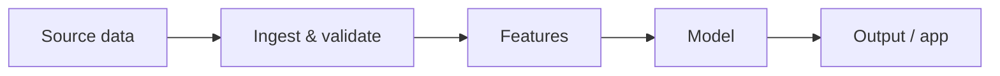

<!--
TEMPLATE README. Replace every _italic placeholder_. Delete sections that do not apply
(e.g. "Model development" for a pure data-engineering project) rather than leaving them empty.
Rule: never state a metric, business impact or deployment status that the code in this repo
does not reproduce. See docs/README_STANDARD.md.
-->

# _Project Title_

_One sentence: what this does and for whom._


**Status:** _In development / Complete / Deployed at <link>_


## At a glance
| | |
|---|---|
| **Problem** | _The business / clinical / policy question in one line_ |
| **Data** | _Dataset name, size, licence_ |
| **Approach** | _e.g. Gradient-boosted classifier with calibrated probabilities_ |
| **Result** | _Headline metric on the held-out test set, with baseline for comparison_ |
| **Stack** | _Python, pandas, scikit-learn, …_ |

## 1. Business problem
_Why this matters, who makes the decision, what it costs to get it wrong._

## 2. Objectives
- _Measurable objective 1_
- _Measurable objective 2_

## 3. Data
_Source, licence, time period, size, key fields. Full provenance in [data/README.md](data/README.md)._

## 4. Architecture


## 5. Methodology
_Cleaning, missing-data strategy, train/validation/test split and why, leakage controls, baselines._

## 6. Exploratory analysis
_Three to five findings that shaped the modelling, each with a figure._

## 7. Model development
_Models compared, why, cross-validation scheme, tuning, final model choice._

## 8. Results and evaluation
| Model | _Metric 1_ | _Metric 2_ | _Metric 3_ |
|---|---|---|---|
| Baseline | | | |
| _Final_ | | | |

_All numbers from `make evaluate` on the held-out test set._

## 9. Explainability and fairness
_SHAP / feature importance, subgroup performance, known biases. See [docs/MODEL_CARD.md](docs/MODEL_CARD.md)._

## 10. Business interpretation
_What a decision-maker should do with this, in plain English._

## 11. Limitations
- _Honest limitation 1_

## 12. Run it yourself
```bash
git clone https://github.com/MulengaSnr/REPO-NAME.git
cd REPO-NAME
uv sync                 # installs Python 3.12 + dependencies
cp .env.example .env    # only if the project needs credentials
make test
```

### Reproduce the analysis
```bash
# _e.g._ uv run python -m project_name.data.download
# _e.g._ uv run python -m project_name.models.train
```

## 13. Project structure
```
├── configs/        parameters (no hard-coded values in code)
├── data/           raw / processed (gitignored) + provenance README
├── docs/           model card, design notes
├── notebooks/      narrative analysis
├── reports/        findings.md + figures
├── src/            tested, reusable code
└── tests/
```

## 14. Next steps
- _Planned improvement 1_

## Author
**Enock Mulenga**, Data Scientist · [LinkedIn](https://www.linkedin.com/in/enock-mulenga-8472ba137) · [Portfolio](https://mulengasnr.github.io)
